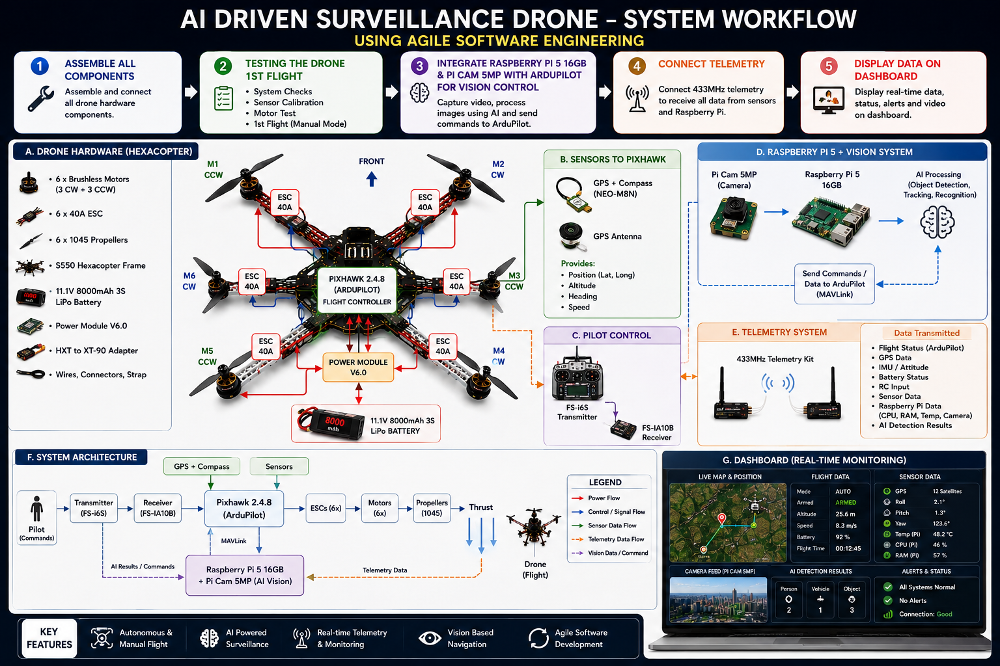

# AI-Driven Surveillance Drone

## Introduction

**AI-Driven Surveillance Drone** is a major project focused on the development of an intelligent unmanned aerial vehicle (UAV) for aerial surveillance. The project uses a hexacopter platform and follows an Agile Software Engineering approach.

## Project Diagram

## Documentation

### Software Requirements Specification (SRS)

- [Software Requirements Specification](Doc/SRS.pdf)

## License

This project is licensed under the [MIT License](LICENSE).
